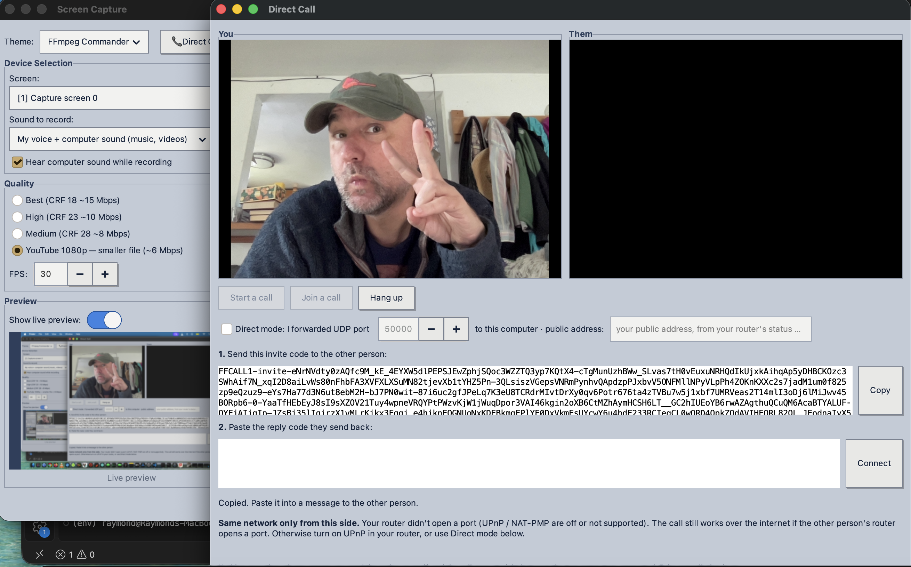

# Screen Capture for Mac & Linux

  

A free, self-contained screen recorder for Mac and Linux. Record your screen
with your voice, with the computer's sound, or both mixed together in one file.

**New in 1.6 for Mac: Direct Call**, encrypted video calls from your Mac
straight to another Mac. No server, no account, no middle man.

Full instructions, permission setup, and FAQ:
**https://ffmpegcommander.com/screen-recorder.html**

## Mac

**[⬇ Download the latest version](https://github.com/rompstar/screen-capture-mac/releases/latest/download/ScreenCapture_Mac.zip)**

> [!NOTE]
> **Signed & notarized by Apple.** Built by a registered Apple Developer and notarized by Apple, so it opens the normal way with a double-click. No "unidentified developer" warning, no right-click workaround, nothing extra to do.

- Mac with Apple Silicon (M1 or newer)
- Recording the computer's sound needs the free
  [BlackHole](https://existential.audio/blackhole/) audio driver — the app has
  a one-click installer for it built in

### Direct Call new in 1.6

Video calls from your Mac straight to theirs, built into the same free app.
Press **📞 Direct Call…** at the top of the window.

- **No middle man.** No server, no account, no sign-up. The video goes
  directly from one Mac to the other; nothing in between can see it or log it.
- **You introduce the two Macs.** Send an invite code by text, email or
  Signal; the other person sends a reply code back. That's the whole setup.
- **Encrypted the whole way** (WebRTC: DTLS-SRTP with AES-128), with fresh keys
  for every call that are deleted when you hang up.
- **15-digit safety code.** Read it to each other: if both screens match,
  nobody is sitting in the middle.
- **Echo cancellation built in**, so you can talk on speakers, plus soft chimes
  when a call connects, ends or drops.
- **Works over the internet, no router setup on most home networks.** Each code carries that
  Mac's public address; when you press Connect both Macs reach each other
  directly. Mac to Mac for now (1.6.1 or newer on both sides).

How it works and how it's encrypted:
**https://ffmpegcommander.com/direct-call.html**

## Linux (Beta)

**[⬇ Download for Linux](https://github.com/rompstar/screen-capture-mac/releases/download/linux-v1.0.2/LinuxScreenRecorder_GTK4_20261010-095752_linux_x86_64.tar.gz)**

> [!NOTE]
> **Requires a real X11/Xorg session, not Wayland.** The app tries PipeWire first automatically (the modern, Wayland-native capture path) and validates it's actually returning real content — if that check fails, it falls back to FFmpeg's `x11grab`, which needs a genuine X11 session. Having XWayland installed alone isn't enough for that fallback. Full explanation and the fix, if you need it: [download page](https://ffmpegcommander.com/screen-recorder.html#linux-section).

- x86_64 Linux (not ARM)
- ~303 MB download — everything's bundled (FFmpeg 9, GTK4, GStreamer, PulseAudio/PipeWire client libraries), no package manager or root password needed
- Extract and run: `tar -xzf LinuxScreenRecorder_*.tar.gz`, then `./run.sh`

## What it does

- Records your screen to MP4 — hardware-encoded on Mac (Apple VideoToolbox H.264)
- Three sound modes: your voice, the computer's sound, or both mixed
- Live monitoring — keep hearing the audio while you record
- Live preview of exactly what's being recorded, with an on/off switch
- **Mac:** Direct Call, private video calls Mac to Mac (see above)
- Everything runs locally. No account, no cloud, no uploads. Recordings never
  leave your computer, and calls go only to the person you're calling.

## From the maker of FFmpeg Commander

This tool grew out of [FFmpeg Commander](https://ffmpegcommander.com), a full
video toolbox for Mac, Windows, and Linux — converting, editing, transcribing,
all local on your machine. If you want to edit what you record, that's the tool
for it.
